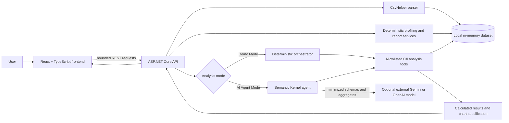
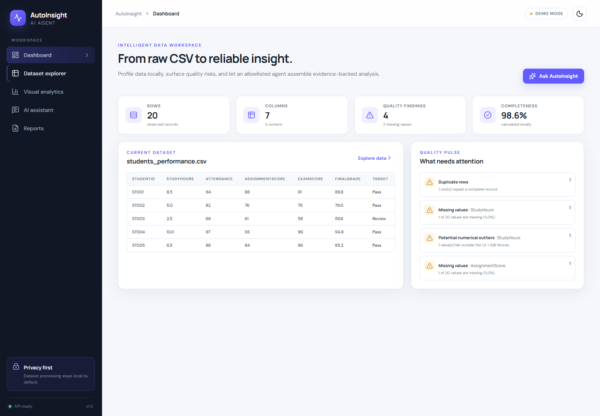
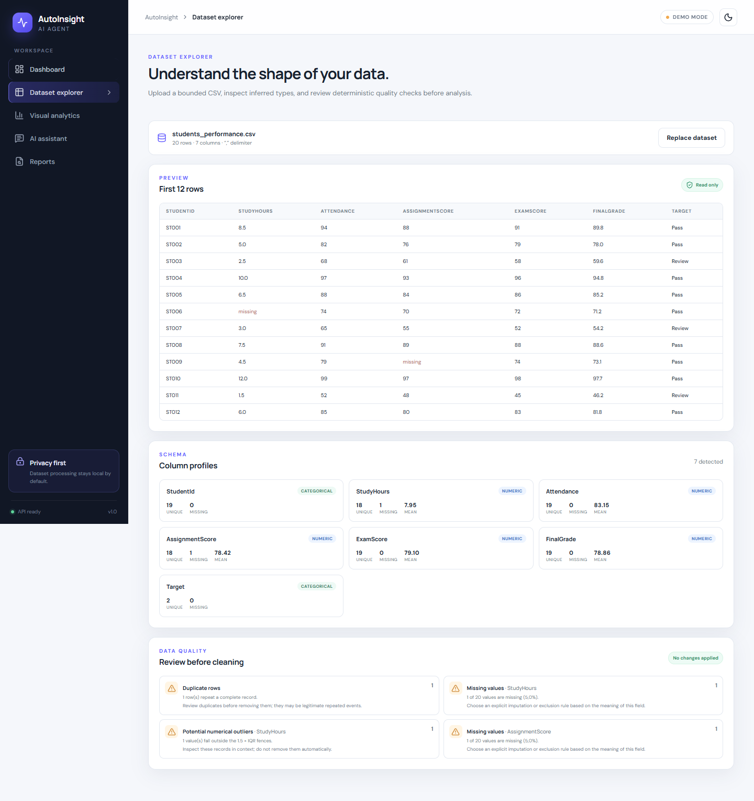
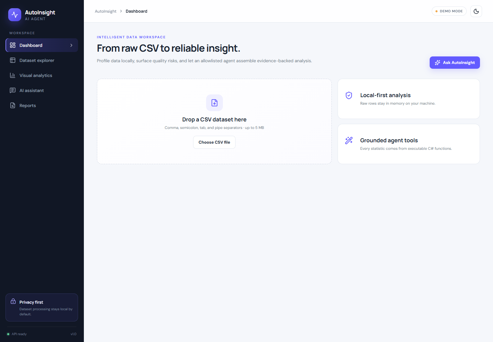
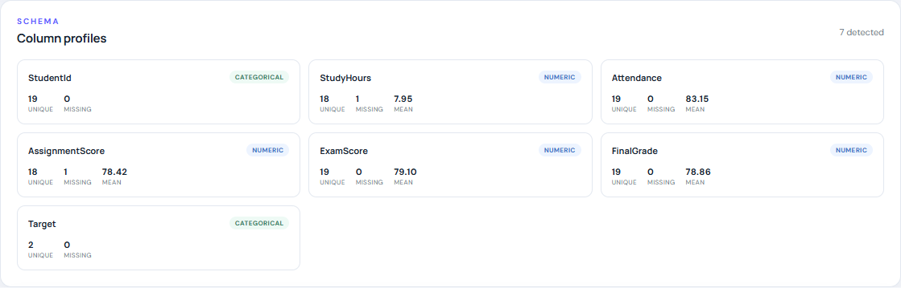
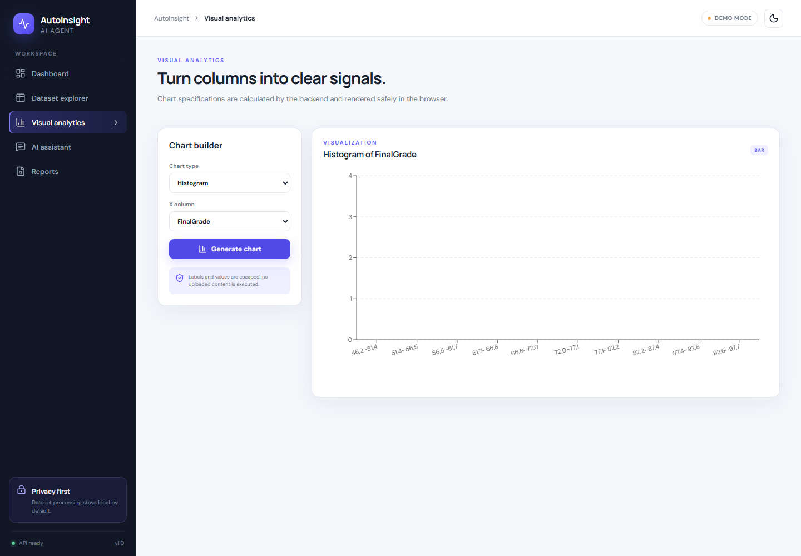
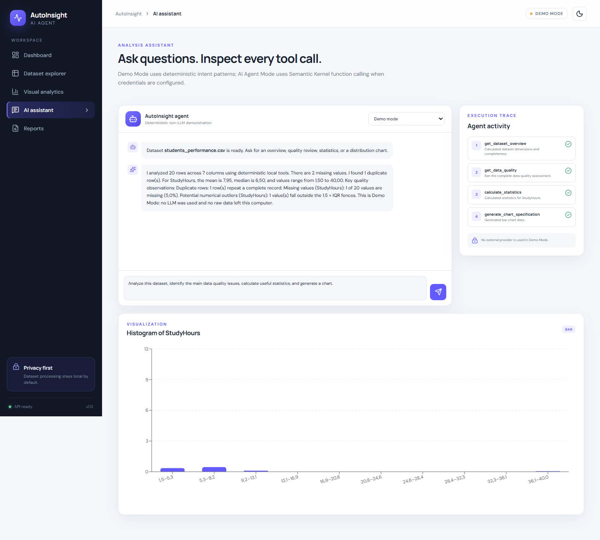
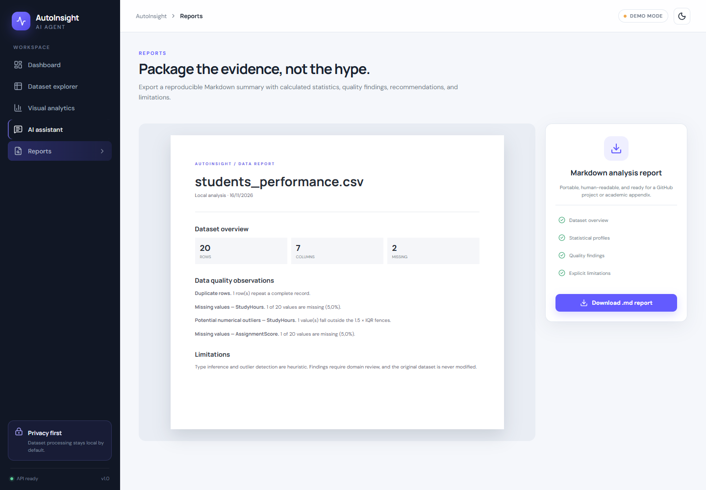

# AutoInsight AI Agent

**Intelligent Autonomous Data Analysis Platform**

[](https://github.com/Melek-Lahmar/AutoInsight-AI-Agent/actions/workflows/ci.yml)


[](LICENSE)

AutoInsight turns uploaded CSV files into inspectable profiles, data-quality findings, descriptive statistics, visualizations, and grounded natural-language analysis. It was developed as an independent academic portfolio project to explore how deterministic analytical software can be combined safely with an LLM that selects and invokes real C# tools.

The application remains fully useful without an API key. Its deterministic Demo Mode and model-backed AI Agent Mode are visibly separated, so calculated facts are not confused with generated interpretation.

## Overview

Traditional analytics requires a user to select each operation manually. AI-assisted analytics adds natural-language explanation. AutoInsight goes one step further in AI Agent Mode: a model interprets the objective, selects from a restricted Semantic Kernel toolset, and coordinates multiple analytical operations while the backend performs every calculation locally.

The design keeps responsibilities explicit:

- **deterministic analytics** calculate profiles, statistics, quality findings, outliers, and chart data;
- **AI-assisted interpretation** explains calculated results in plain language;
- **autonomous tool selection** lets the model choose the necessary functions for a request;
- **observable execution** returns tool names, durations, success states, and an optional local chart specification.

Raw rows are not placed in the model prompt. Only the user's question and minimized analytical outputs are sent to the configured provider.

## Features

### Data exploration

- bounded CSV upload and validation;
- automatic delimiter detection for comma, semicolon, tab, and pipe files;
- dataset preview, dimensions, schema inference, and column identification;
- numeric, categorical, date, and text type inference.

### Data quality

- missing-value counts and percentages;
- complete-row duplicate detection;
- mixed-type, constant-column, and category-imbalance findings;
- potential numeric outliers using the 1.5 × IQR rule;
- non-destructive recommendations that never mutate the uploaded source.

### Statistical analysis

- count, minimum, maximum, mean, median, quartiles, and population standard deviation;
- numeric distributions and category frequencies;
- deterministic, independently testable calculations.

### Visualization and reporting

- interactive bar, categorical-frequency, histogram, line, scatter, and missing-value charts;
- safe server-generated chart specifications rendered with Recharts;
- downloadable Markdown reports with methodology and limitations.

### Agentic AI

- natural-language analytical requests;
- genuine Semantic Kernel function calling with Gemini or OpenAI;
- autonomous selection and multi-step use of allowlisted C# functions;
- grounded explanations and visible execution traces;
- deterministic Demo Mode when no external model is configured;
- request timeouts and tool-invocation limits.

The agent has no shell, filesystem, SQL, arbitrary HTTP, or code-execution tool.

## Technology stack

| Layer | Technology |
|---|---|
| Backend | ASP.NET Core 10 / C# |
| Frontend | React 19 / TypeScript 7 / Vite 8 |
| AI orchestration | Microsoft Semantic Kernel 1.82 |
| AI connectors | Google Gemini connector 1.82 alpha; OpenAI connector 1.82 |
| Data processing | CsvHelper 34 / LINQ |
| Visualization | Recharts 3 |
| API | REST / OpenAPI / Swagger |
| Backend testing | xUnit / `WebApplicationFactory` |
| Frontend testing | Vitest / Testing Library |
| Quality | oxlint / GitHub Actions |

## System architecture



See [the detailed architecture document](docs/architecture/architecture.md) for the runtime sequence, statistical conventions, and trust boundaries.

## Screenshots

All images below were captured from the running application with the bundled synthetic student dataset. The assistant image shows the credential-free Demo Mode; a model-backed trace is documented only after a real provider test succeeds.

| Dashboard and CSV upload | Dataset overview |
|---|---|
|  |  |
|  |  |

| Interactive visualization | Assistant and execution trace |
|---|---|
|  |  |



## Installation and quick start

### Prerequisites

- Windows 10 or 11;
- [.NET SDK 10.0.201](https://dotnet.microsoft.com/download/dotnet/10.0) or a compatible later 10.0 patch;
- [Node.js 24](https://nodejs.org/) and npm 11 or later;
- Git; PowerShell 7 is recommended.

No database or Docker installation is required.

### Clone and install

```powershell
git clone https://github.com/Melek-Lahmar/AutoInsight-AI-Agent.git
cd AutoInsight-AI-Agent
dotnet restore --locked-mode
cd frontend
npm ci
cd ..
```

### Start the application

Run the backend and frontend in separate terminals:

```powershell
./scripts/start-backend.ps1
```

```powershell
./scripts/start-frontend.ps1
```

Alternatively, `./scripts/start-all.ps1` launches both local processes. Stop them with `./scripts/stop-all.ps1`.

| Service | Development URL |
|---|---|
| Web application | `http://localhost:5173` |
| Backend API | `http://localhost:5000` |
| Swagger UI | `http://localhost:5000/swagger` |
| Health endpoint | `http://localhost:5000/api/health` |

Upload a synthetic file from [`sample-data/`](sample-data/) to explore the complete workflow.

## AI configuration

### Demo Mode

Demo Mode requires no credential. It maps supported request patterns to the same deterministic C# analysis services used by the real agent and labels every response as non-LLM execution.

### Real AI Agent Mode

Gemini is the recommended development option because compatible Gemini models support function calling and Google offers a limited free tier. The application also supports OpenAI. Provider quotas, model availability, pricing, and data-use terms can change; check the provider's current documentation before use.

Store credentials in ASP.NET Core User Secrets, never in the repository:

```powershell
dotnet user-secrets set "AI_PROVIDER" "gemini" --project backend/AutoInsight.Api
dotnet user-secrets set "AI_MODEL" "gemini-3.8-flash" --project backend/AutoInsight.Api
dotnet user-secrets set "AI_API_KEY" "PASTE_THE_KEY_LOCALLY" --project backend/AutoInsight.Api
```

For OpenAI, set `AI_PROVIDER` to `openai` and select a currently supported function-calling model. Environment variables with the same names are also supported for ephemeral local sessions and CI environments. The frontend receives only the provider name, model name, and whether AI is configured; it never receives the API key.

Privacy note: the source CSV stays in local process memory, but the question and minimized analytical aggregates are transmitted to the selected external model. On some free tiers, provider terms may permit submitted data to be used for product improvement. Do not use sensitive, confidential, or regulated data without reviewing the applicable terms and organizational policy.

After configuring a provider and starting the backend, execute the five-scenario model evaluation with:

```powershell
./scripts/test-real-ai.ps1
```

## Usage examples

1. “Identify missing values in this dataset and explain which columns need attention.”
2. “Calculate the average exam score and summarize the score distribution.”
3. “Detect numerical outliers and explain the IQR rule used.”
4. “Generate a histogram of exam scores.”
5. “Analyze this dataset, identify missing values, calculate the average exam score, detect potential outliers, and generate a chart.”

## Testing and evaluation

Run the complete local suite:

```powershell
./scripts/run-tests.ps1
```

Or run each layer independently:

```powershell
dotnet restore --locked-mode
dotnet build -c Release --no-restore
dotnet test -c Release --no-build --no-restore

cd frontend
npm ci
npm run lint
npm test -- --run
npm run build
```

The published CI performs the same credential-free checks. It intentionally makes no paid model calls.

| Test scenario | Expected behavior | Observed result | Status |
|---|---|---|---|
| Backend build and tests | Solution restores, builds, and deterministic tests pass | Release build: 0 warnings/0 errors; 22 of 22 tests passed | Pass |
| Frontend lint, tests, and build | Static checks, component tests, and production bundle pass | oxlint passed; 3 of 3 tests passed; Vite production build completed | Pass |
| Complete Demo Mode workflow | Upload, profile, chat, chart, and report endpoints return grounded results | Verified locally with the synthetic student dataset | Pass |
| Invalid or missing AI credential | API rejects AI mode safely without revealing a credential | Verified by API integration test | Pass |
| Five genuine model-backed prompts | Semantic Kernel invokes real tools through an external model | Requires a locally supplied provider credential | Not yet verified |

Test results are updated only after actual execution; the presence of configuration code is not treated as proof of a successful external model call.

## Project structure

```text
AutoInsight-AI-Agent/
├── backend/
│   ├── AutoInsight.Api/             # HTTP endpoints, validation, Swagger, configuration
│   ├── AutoInsight.Core/            # domain records and service contracts
│   ├── AutoInsight.Infrastructure/  # CSV, analytics, reporting, and agent implementations
│   └── AutoInsight.Tests/           # unit and API integration tests
├── frontend/                        # React, TypeScript, Recharts, and component tests
├── sample-data/                     # synthetic evaluation datasets
├── scripts/                         # local start, stop, test, and model-evaluation scripts
├── docs/
│   ├── architecture/                # technical architecture and trust boundaries
│   └── screenshots/                 # genuine local application captures
├── .github/workflows/ci.yml         # credential-free CI pipeline
└── AutoInsight.slnx
```

## Security and privacy

- CSV files are untrusted data, never executable instructions.
- Extension, byte-size, row-count, and column-count limits reduce resource abuse.
- Parsed datasets live under opaque IDs in memory and disappear when the API stops.
- Raw rows and secrets are not logged or placed in the LLM prompt.
- Tool outputs are minimized: previews, raw categorical identifiers, and chart points remain local.
- Agent functions are explicitly allowlisted and protected by invocation and request-time limits.
- The model cannot access a shell, arbitrary code, SQL, local files, or unrestricted network tools.
- Errors use safe problem details rather than leaking stack traces or provider responses.
- `.gitignore`, a staged-file review, dependency audits, and secret scans protect publication.

Prompt injection in an uploaded cell cannot grant new capabilities: dataset values are parsed as data, and the model can call only the registered functions. External providers remain a separate trust boundary.

## Limitations

- Only CSV uploads are supported; the default limit is 5 MB, 50,000 rows, and 100 columns.
- Storage is ephemeral, single-node, and unauthenticated; this is a local portfolio application, not a multi-tenant service.
- Type inference, IQR outliers, and imbalance detection are statistical heuristics, not domain truth.
- Quartiles use linear interpolation and standard deviation is calculated for the population.
- Real AI Agent Mode needs a user-provided provider account, key, and available quota.
- The Semantic Kernel Gemini connector used here is currently prerelease software.
- Model responses can still be incomplete or misleading and must be checked against the visible tool trace.
- The initial frontend bundle is not route-level code split.

## Future roadmap

- reversible data-cleaning pipelines and advanced missing-value strategies;
- correlation analysis and richer statistical tests;
- ML.NET experimentation and model-training workflows;
- persisted, authenticated multi-user sessions;
- PDF report generation;
- database and cloud-storage connectors;
- multi-agent research workflows after the single-agent core is evaluated;
- systematic model evaluation, telemetry, accessibility testing, and performance monitoring.

These items are proposed future work, not current functionality.

## Author and academic context

**Author: Melek Lahmar**

Academic background: Bachelor's degree in Information Technology — Information Systems Development.

AutoInsight is an independent personal software engineering and AI portfolio project developed for learning and MSc application preparation in Artificial Intelligence, Computer Science, and Data Science. It is not affiliated with or endorsed by Microsoft, Google, OpenAI, 365 Data Science, Hugging Face, or any university.

A concise CV-ready description is available in [`docs/academic-cv-description.md`](docs/academic-cv-description.md), and a publication draft is available in [`docs/linkedin-draft.md`](docs/linkedin-draft.md).

## License

This project is released under the [MIT License](LICENSE).
