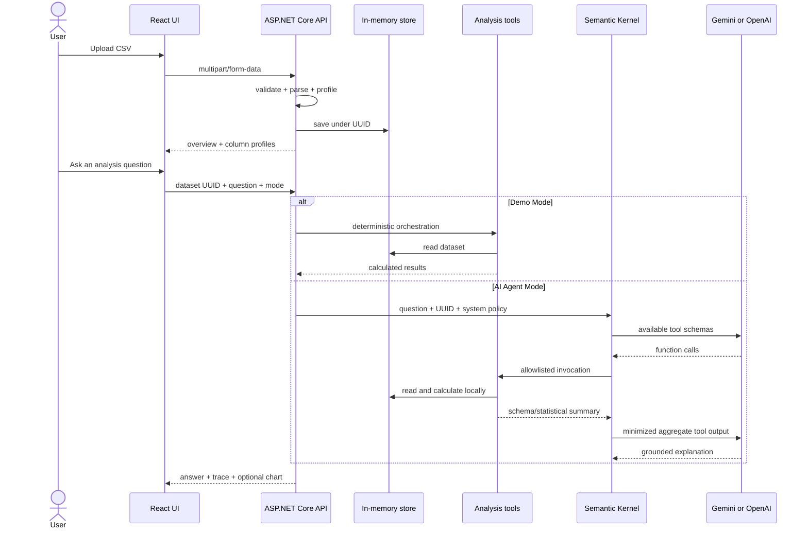

# AutoInsight architecture

## Runtime boundaries

The browser never parses the source CSV or holds an AI credential. It uploads a bounded file to the API, receives typed DTOs, and renders safe chart data. The API stores each parsed dataset under an opaque UUID in process memory, retains at most ten datasets, and accepts loopback clients only by default.

## Agent tool surface

`DatasetAnalysisPlugin` exports these Semantic Kernel functions:

- `get_dataset_overview`
- `get_column_information`
- `get_missing_values`
- `get_duplicate_rows`
- `calculate_statistics`
- `get_categorical_distribution`
- `detect_outliers`
- `get_data_quality`
- `generate_chart_specification`

Each function resolves a dataset UUID against the in-memory store, delegates to deterministic services, serializes a minimized result, and appends a user-visible trace entry only after successful completion. Failed calls are logged without being presented as successful tool evidence. Dataset previews, raw chart points, and high-cardinality categorical identifiers remain local. The plugin rejects calls after the configured maximum. The request also has a cancellation timeout.

## Statistical conventions

- mean: arithmetic mean over valid numeric values
- median and quartiles: linear interpolation over sorted observations
- standard deviation: population standard deviation
- outliers: values outside `Q1 - 1.5 × IQR` and `Q3 + 1.5 × IQR`
- duplicate: a row whose complete normalized field sequence already occurred
- missing: empty or whitespace-only input after parsing

These are calculated observations. Quality labels and recommendations are rule-based interpretations and must be reviewed with domain knowledge.

## Security decisions

The system does not expose file paths, shell commands, arbitrary code, SQL, or unrestricted HTTP tools to the model. CSV cell contents are never treated as prompts. The API logs tool names and timings, not rows or secrets. CORS is constrained to `FrontendOrigin`, host headers are restricted, and non-loopback clients receive a 403 response while `LocalOnly` is enabled.

AI credentials are loaded server-side from environment variables or ASP.NET Core User Secrets. The browser can see whether a provider is configured but never receives the credential. External model providers form a separate privacy boundary: questions and minimized analytical aggregates leave the local process when AI Agent Mode is used.
